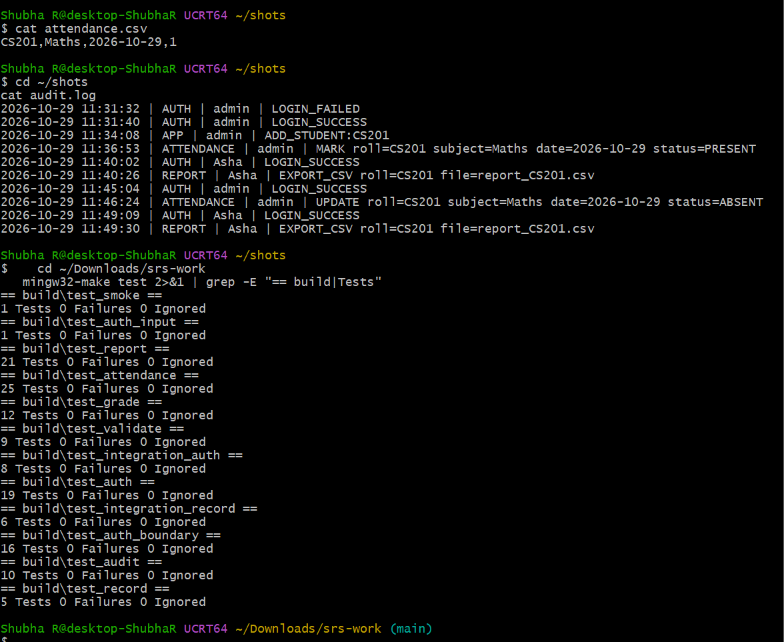
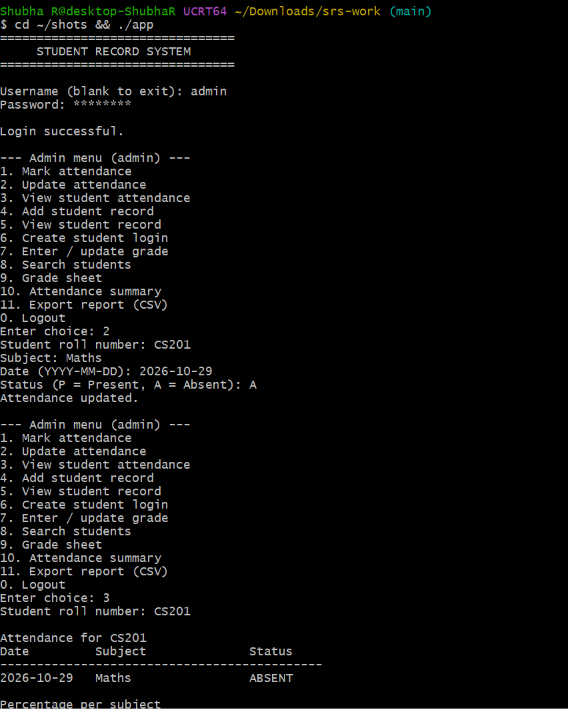
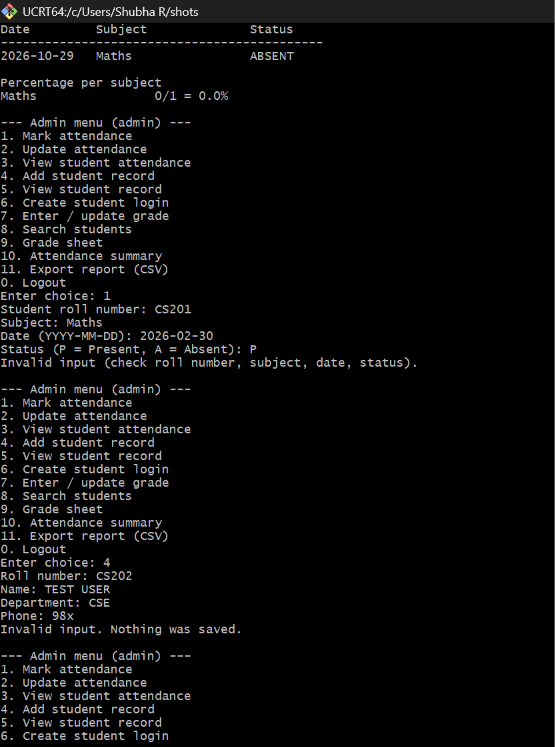
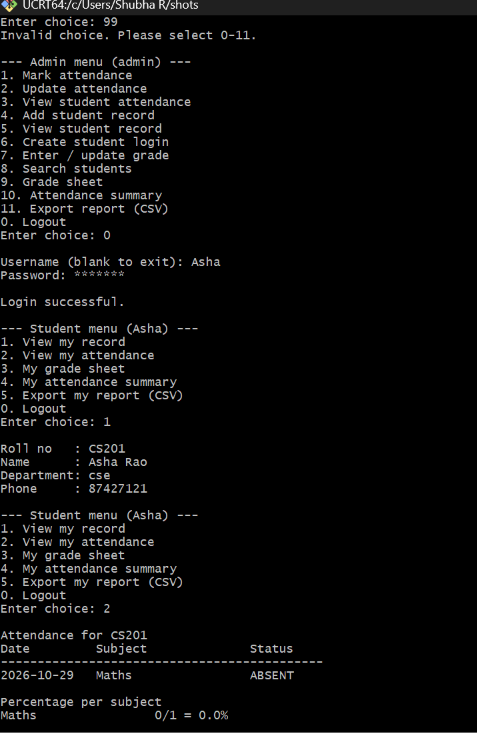
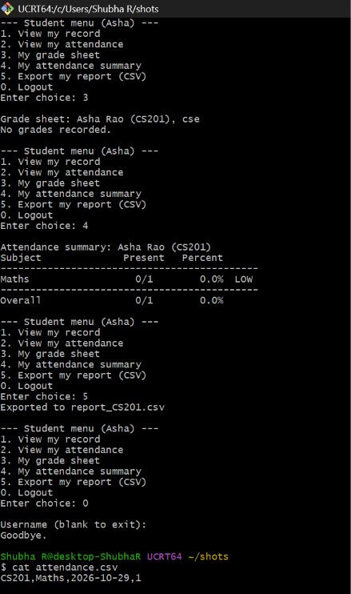

# Jackfruit Phase-3 Test Cases: Attendance, Validation, Console Menu

Shubha R (Member 4), PES2UG24CS660, Team 12 Student Record System.

This follows the Jackfruit Phase-3 template: Test Case ID, Module, Description, Preconditions, Test Steps, Test Data, Expected Result, Actual Result, Test Result. It has 31 cases across three use cases, mixing unit, integration and system tests.

Evidence:
- Unit and integration rows come from `mingw32-make test`. `test_attendance` ran 25 tests and `test_validate` ran 9 tests, all with 0 failures (screenshot 1).
- System rows come from manual runs of the app on the latest `main`. The Actual Result is the text that appeared on screen, or the data saved in `attendance.csv` and `audit.log`.

## Use case 1: Attendance (mark, correct, view, percentage)

| Test Case ID | Module | Description | Preconditions | Test Steps | Test Data | Expected Result | Actual Result | Test Result |
|---|---|---|---|---|---|---|---|---|
| TC-Att-01 | Attendance (Unit) | Admin marks attendance and the entry is saved | Empty attendance file; admin session | Call mark_attendance as admin | PES001, Maths, 2026-10-12, Present | Returns OK; file has `PES001,Maths,2026-10-12,0` | OK returned; line saved in file | Pass |
| TC-Att-03 | Attendance (Unit) | Student cannot mark attendance | Student session | Call mark_attendance as a student | PES001, Maths, 2026-10-12, Present | Permission denied; nothing written | Permission denied; file empty | Pass |
| TC-Att-07 | Attendance (Unit) | Duplicate entry is rejected | Entry for PES001, Maths, 2026-10-12 exists | Mark the same entry again as Absent | PES001, Maths, 2026-10-12, Absent | Duplicate error; original entry kept | Duplicate error returned | Pass |
| TC-Att-11 | Attendance (Unit) | Unknown student is rejected | Student NOBODY1 has no record | Call mark_attendance for NOBODY1 | NOBODY1, Maths, 2026-10-12, Present | Unknown-student error; nothing saved | Unknown-student error; file empty | Pass |
| TC-Att-12 | Attendance (Unit) | A prior entry can be corrected | Entry exists as Absent | Call update_attendance with Present | PES001, Maths, 2026-10-12, Present | Entry becomes `...,0`; audit log has UPDATE | Entry corrected; UPDATE logged | Pass |
| TC-Att-16 | Attendance (Unit) | Zero classes gives 0% with no crash | No records for the student | Call calculate_percentage | PES001, Maths | Returns OK with 0.0; no divide by zero | OK with 0.0 | Pass |
| TC-Att-19 | Attendance (Unit) | Percentage is calculated per subject | Maths: 3 present, 1 absent; Physics: 1 absent | Call calculate_percentage for each subject | PES001, Maths and Physics | Maths 75.0; Physics 0.0 | Maths 75.0; Physics 0.0 | Pass |
| TC-Att-05 | Attendance (Unit) | A successful mark is audit-logged | Audit log initialised | Mark attendance, then read the audit log | PES001, Maths, 2026-10-12, Present | Log line contains ATTENDANCE, admin and PES001 | Log line present | Pass |
| TC-Att-21 | Attendance (Integration with auth) | A student views only their own attendance | Records exist for PES001 and PES002 | Student PES001 views PES001, then PES002 | PES001 and PES002 | Own record shown; other student denied | Own shown; other denied | Pass |
| TC-Att-S01 | Attendance (System) | Mark attendance from the menu | Logged in as admin; student CS201 exists | Menu 1; enter the test data | CS201, Maths, 2026-10-29, P | `Attendance marked.`; line added to attendance.csv | Entry saved as CS201,Maths,2026-10-29,0 and audit log shows MARK roll=CS201 ... status=PRESENT (11:36:53). On-screen message not captured. | Pass |
| TC-Att-S02 | Attendance (System) | Update with no existing entry is refused | Logged in as admin | Menu 2; enter the test data | 12, maths, 2007-10-19, P | `No existing entry to update.` | `No existing entry to update.` | Pass |

## Use case 2: Input validation (STU-SR004)

| Test Case ID | Module | Description | Preconditions | Test Steps | Test Data | Expected Result | Actual Result | Test Result |
|---|---|---|---|---|---|---|---|---|
| TC-Sec-05a | Validation (Unit) | Valid roll numbers are accepted | None | Call validate_roll_no | PES001, CS-101, a_1, a 15-character roll | Returns 1 for each | Returned 1 for each | Pass |
| TC-Sec-05b | Validation (Unit) | Invalid roll numbers are rejected | None | Call validate_roll_no | NULL, empty, 16 characters, `PES 001`, `PES,001`, `PES001;`, `-` | Returns 0 for each | Returned 0 for each | Pass |
| TC-Sec-05c | Validation (Unit) | Valid dates are accepted, including leap years | None | Call validate_date | 2026-10-23, 2024-02-29, 2000-02-29 | Returns 1 for each | Returned 1 for each | Pass |
| TC-Sec-05d | Validation (Unit) | Malformed or impossible dates are rejected | None | Call validate_date | 2025-02-29, 1900-02-29, 2026-13-01, 2026-04-31, 2026-1-01, abcd-ef-gh | Returns 0 for each | Returned 0 for each | Pass |
| TC-Sec-05e | Validation (Unit) | Valid marks are accepted and the value returned | None | Call validate_marks | 0, 75, 100 | Returns 1; value matches input | Returned 1; values matched | Pass |
| TC-Sec-05f | Validation (Unit) | Out-of-range or non-numeric marks are rejected | Output value set to 42 | Call validate_marks | 101, -1, abc, 1.5, empty | Returns 0; output value stays 42 | Returned 0; value stayed 42 | Pass |
| TC-Sec-05g | Validation (Unit) | Text with commas or line breaks is rejected | None | Call validate_text with limit 31 | `Maths,Physics`, text with a newline, a carriage return, a tab, empty, spaces only | Returns 0 for each; normal text returns 1 | Matched | Pass |
| TC-Sec-05h | Validation (Unit) | Text length limit is enforced | None | Call validate_text with limit 5 | abcde, abcdef | abcde returns 1; abcdef returns 0 | Matched | Pass |
| TC-Sec-05i | Validation (Unit) | Phone rules are enforced | None | Call validate_phone | 9876543210, +919876543210, 12345, 98765x3210 | First two return 1; last two return 0 | Matched | Pass |
| TC-Sec-05j | Validation (System) | The menu rejects an impossible date | Logged in as admin; student CS201 exists | Menu 1; enter the test data | CS201, Maths, 2026-02-30, P | `Invalid input (check roll number, subject, date, status).`; nothing saved | Invalid input (check roll number, subject, date, status). | Pass |
| TC-Sec-05k | Validation (System) | The menu rejects an invalid phone number | Logged in as admin | Menu 4; enter the test data | CS202, TEST USER, CSE, 98x | `Invalid input. Nothing was saved.` | Invalid input. Nothing was saved. | Pass |

## Use case 3: Console menu and login

| Test Case ID | Module | Description | Preconditions | Test Steps | Test Data | Expected Result | Actual Result | Test Result |
|---|---|---|---|---|---|---|---|---|
| TC-Menu-01 | Console menu (System) | A wrong login is refused | App started in a fresh folder | Enter a wrong username and a password | Username admin123, any password | `Invalid username or password.` | `Invalid username or password.` (audit log: LOGIN_FAILED) | Pass |
| TC-Menu-02 | Console menu (System) | Admin can log in | App started | Enter the admin credentials | admin / admin123 | `Login successful.` and the admin menu | `Login successful.` and admin menu shown (audit log: LOGIN_SUCCESS) | Pass |
| TC-Menu-03 | Console menu (System) | Admin adds a student from the menu | Logged in as admin | Menu 4; enter the test data | CS201, Asha Rao, CSE, phone | `Student added.` | Student saved (audit log: ADD_STUDENT:CS201) | Pass |
| TC-Menu-04 | Console menu (System) | Admin creates a student login | Logged in as admin | Menu 6; enter the test data | Asha, roll CS201, a password | `Student login created.` | Student login works (audit log: Asha LOGIN_SUCCESS) | Pass |
| TC-Menu-05 | Console menu (System) | Attendance for an unregistered student is refused | Student 12 not yet added | Menu 1; enter the test data | 12, maths, 2007-10-30, P | `No such student.` | `No such student.` | Pass |
| TC-Menu-06 | Console menu (System) | Viewing attendance with no records | Student 13 exists with no attendance | Menu 3; enter the roll number | 13 | `No attendance records found.` | `No attendance records found.` | Pass |
| TC-Menu-07 | Console menu (System) | An invalid menu choice is refused | Logged in as admin | Enter an option that does not exist | 99 | An invalid-choice message; the menu is shown again | Invalid choice. Please select 0-11. The admin menu was shown again. | Pass |
| TC-Menu-08 | Console menu (System) | A student login shows the student menu | Student login Asha exists | Log out; log in as the student | Asha and her password | Student menu with own record and own attendance | Login successful. Student menu (Asha) showed: View my record, View my attendance, My grade sheet, My attendance summary, Export my report (CSV), Logout. | Pass |
| TC-Menu-09 | Console menu (System) | A student views their own attendance | Logged in as the student; records exist | Choose view my attendance | Student CS201 | Own attendance table with percentage per subject | Attendance for CS201: 2026-10-29, Maths, ABSENT; Percentage per subject: Maths 0/1 = 0.0%. | Pass |

## Evidence screenshots

1. Saved data and unit tests: `attendance.csv` ends in `,1` after the correction, the audit log shows the MARK and UPDATE lines, and the unit tests show `test_attendance` 25 and `test_validate` 9 with 0 failures.

   

2. Correction and percentage (TC-Att-12 at system level): `Attendance updated.`, then the view shows `Maths 0/1 = 0.0%`.

   

3. Rejected inputs (TC-Sec-05j and TC-Sec-05k): the impossible date and the invalid phone number.

   

4. Invalid choice and student view (TC-Menu-07, 08, 09): option 99, the student login and the student's own attendance.

   

5. Student menu: grade sheet, attendance summary, export, logout, and the final `attendance.csv`.

   
